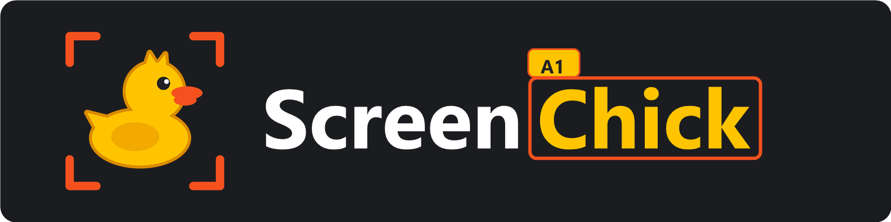
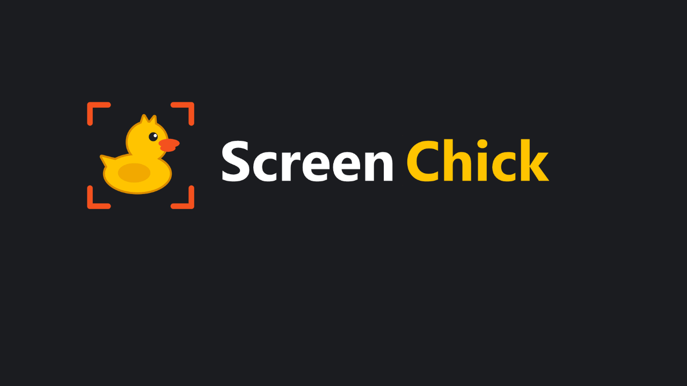
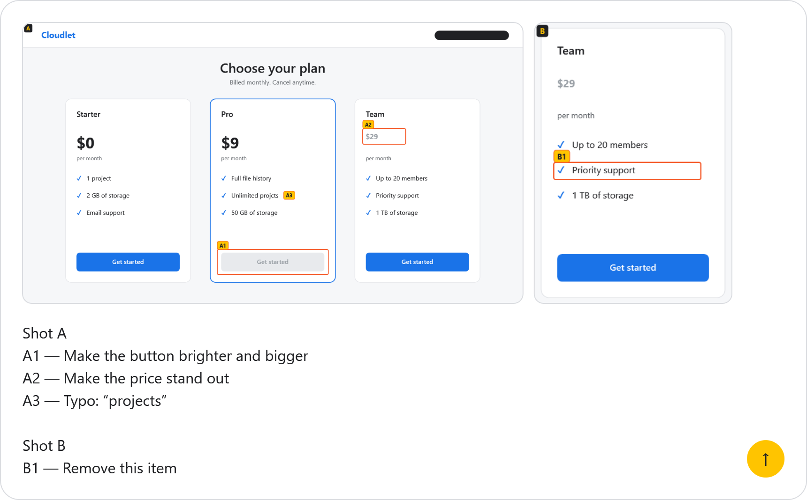
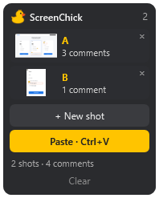

<p align="center">
  
</p>

<p align="center">
  <a href="README.md">Русский</a> · <b>English</b>
</p>

<h3 align="center">Circle it, comment it, press Ctrl+V. The chat knows exactly what you mean.</h3>

<p align="center">Annotated screenshots for AI assistants and team chats.</p>

<p align="center">
  <a href="https://github.com/EvgLans/ScreenChick/releases/latest"></a>
  <a href="https://github.com/EvgLans/ScreenChick/releases"></a>
  <a href="LICENSE"></a>
</p>

<p align="center">
  
</p>
<p align="center"><sub>The pricing page and the chat are made up. The marks, the toolbar and the strip are real, drawn by the app itself.</sub></p>

## How it works

<table>
  <tr>
    <th width="33%">1. Capture</th>
    <th width="33%">2. Mark</th>
    <th width="33%">3. Paste</th>
  </tr>
  <tr>
    <td valign="top"><b>Print Screen</b> freezes the monitor under your cursor. You can change the key in settings.</td>
    <td valign="top">Circle a spot or click it, then type a comment. Redact or crop whatever shouldn't be seen.</td>
    <td valign="top">Put the cursor in the chat box and press <b>Ctrl+V</b>. Shots go in first, then the comments. You press Send yourself.</td>
  </tr>
</table>

Here's what lands in the chat box, with the shots waiting in the side strip:

<table>
  <tr>
    <td width="74%"></td>
    <td valign="top" align="center"></td>
  </tr>
</table>

## Features

- **Numbered marks.** Every comment says which spot it's about: A1, A2, B1.
- **Redact and crop.** The final image is rebuilt from scratch, so the original pixels don't survive under a redaction.
- **Up to 26 shots at a time.** They all go in with one Ctrl+V.
- **One set of shots, many chats.** Shots stay in the strip after pasting until you clear them.
- **Stays out of your way.** Copy something else and Ctrl+V pastes that. The strip's button still pastes the shots.
- **English and Russian.** The language follows Windows, or you can pick it in settings.

## Install

Download `ScreenChick-Setup-*.exe` from [Releases](https://github.com/EvgLans/ScreenChick/releases/latest) and run it. You need 64-bit Windows 10 or 11. You don't need admin rights or a separate .NET install: the runtime comes with the installer, and the app installs for the current user only.

<details>
<summary><b>Windows shows a SmartScreen warning</b></summary>
<br>

The installer isn't signed, so Windows may warn you. Click "More info", then "Run anyway". If you'd rather not trust a prebuilt file, build the app from source using the steps below.

</details>

<details>
<summary><b>Updating and uninstalling</b></summary>
<br>

Before updating or uninstalling, quit the app from its tray menu. To remove it, use Apps in Windows Settings. Your settings file in `%APPDATA%\ScreenChick` stays behind.

</details>

## Where it works

| Chat | Pasting shots and text |
|---|---|
| Claude | ✅ |
| Telegram | ✅ |
| ChatGPT | ✅ |
| Google AI Mode | ✅ |
| WhatsApp, Cursor and others | not tested yet, please report in [Issues](https://github.com/EvgLans/ScreenChick/issues) |

The app has been tested on one Windows 10 PC. Linux and macOS aren't supported, because it's built on WPF and Windows features.

## Using it

The app lives in the tray. Left-click takes a shot, right-click opens the menu with settings and exit. You can turn on autostart in the installer or in settings.

| In capture mode | |
|---|---|
| `1` / `2` / `3` | mark / redact / crop |
| mouse wheel | redaction thickness |
| `Ctrl+Z` / `Ctrl+Y` | undo / redo, with no step limit |
| click a mark | edit or delete it |
| `Enter` | save the shot |
| `Esc` | exit without saving (press twice if you've made edits) |

A mark and the shot's letter stay out of the area you circled. They only end up inside it when there's no room around it.

<details>
<summary><b>How Ctrl+V behaves</b></summary>
<br>

- While the strip is empty, Ctrl+V works as usual.
- While the strip has shots, Ctrl+V pastes them into any window, as many times as you like.
- If you copy something after taking a shot or pasting, Ctrl+V pastes what you copied. The shots stay in the strip, and its Paste button still works.
- If you switch windows during a paste, it stops so your shots don't land in the wrong place. The strip stays as it was, but shots that already went in get pasted again if you retry.
- If a chat doesn't accept all the shots, increase the pause between images in settings.
- Ctrl+V isn't intercepted in windows running as administrator. That's how Windows security works.

</details>

## Privacy

- The app has no network code, no telemetry and no online updates.
- Shots are kept in memory only and disappear when you clear the strip or quit. Only settings are written to disk.
- Shots stay out of the Windows clipboard history (Win+V) and its cloud sync.
- For the capture key and Ctrl+V to work, the app installs a global keyboard hook. It sees every key press, but only acts on those two and records nothing. You can check this in [`KeyRouter.cs`](src/ScreenChick/Input/KeyRouter.cs). Because of this hook, antivirus software may be wary of the app.

<details>
<summary><b>Building from source</b></summary>
<br>

You need the .NET 10 SDK.

```
dotnet test
dotnet run --project src\ScreenChick
```

The installer is built with Inno Setup 6 and lands in `dist`:

```
winget install --id JRSoftware.InnoSetup -e --scope user
powershell -ExecutionPolicy Bypass -File installer\build.ps1
```

Setting `SCREENCHICK_PREVIEW_DIR=<folder>` while running the tests also writes PNGs of the windows, rendered offscreen. That's where the pictures on this page come from. `installer\make-animation.ps1` builds the animation.

</details>

## License

[MIT](LICENSE). The installer includes the .NET runtime from the .NET Foundation and Microsoft; its licenses are in the `licenses` folder next to the installed app. The installer is made with [Inno Setup](https://jrsoftware.org/isinfo.php).
