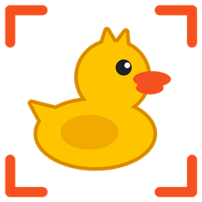

# ScreenChick

**ScreenChick** — утёнок, который приносит в чат скриншоты с пометками. Обведи, что не так, напиши пару слов и нажми Ctrl+V: чат получит картинки вместе с текстом, где понятно, какой комментарий к какому месту относится. Удобно для переписки с ИИ-ассистентами и коллегами.

Работает на Windows 10 и 11, без сети и без учётной записи. Интерфейс на русском.


Что окажется в чате после Ctrl+V:

```
Снимок A
A1 — Кнопку ярче и крупнее
A2 — Цену больше
```

Сначала вставляются сами снимки с теми же метками, затем этот текст. «Отправить» нажимаешь сам: ScreenChick ничего не отправляет.


## Установка

Скачай `ScreenChick-Setup-*.exe` со страницы [Releases](../../releases/latest) и запусти. Нужна 64-битная Windows 10 или 11. Права администратора и отдельный .NET не нужны: среда выполнения входит в установщик, а программа ставится только для текущего пользователя.

Установщик не подписан, поэтому Windows может показать предупреждение SmartScreen: нажми «Подробнее», затем «Выполнить в любом случае». Если не хочешь доверять готовому файлу, собери программу из исходников, инструкция ниже.

Перед обновлением и удалением закрой приложение через меню в трее. Удаляется оно через «Приложения» в параметрах Windows; файл настроек в `%APPDATA%\ScreenChick` при этом остаётся.

## Как пользоваться

Приложение живёт в трее: левый клик делает снимок, правый открывает меню с настройками и выходом. Автозапуск можно включить при установке или в настройках.

1. **Print Screen** замораживает монитор под курсором. Клавишу можно сменить в настройках.
2. **Обведи** место или **кликни** по нему, появится метка A1 и поле для комментария. Enter сохраняет комментарий. Метка и буква снимка не закрывают обведённое: они встают рядом, а внутри окажутся, только если вокруг нет места.
3. **Enter** или «Готово» отправляет снимок в ленту сбоку. Сними ещё, если нужно: в ленте до 26 снимков.
4. Поставь курсор в поле чата и нажми **Ctrl+V**. Сначала вставятся все снимки, затем комментарии с теми же номерами. «Отправить» нажимаешь сам.
5. Снимки остаются в ленте после вставки, так что их можно вставить ещё в другие чаты. Когда они больше не нужны, нажми «Очистить» в ленте или в меню трея.

| В режиме снимка | |
|---|---|
| `1` / `2` / `3` | метка / замазать / обрезать |
| колесо мыши | толщина замазывания |
| `Ctrl+Z` / `Ctrl+Y` | отменить / вернуть, без ограничения шагов |
| клик по метке | поправить или удалить |
| `Enter` | сохранить снимок |
| `Esc` | выйти без сохранения (если есть правки, то двойным нажатием) |

## Поведение Ctrl+V

- Пока лента пуста, Ctrl+V работает как обычно.
- Пока в ленте есть снимки, Ctrl+V вставляет их в любое окно, в том числе повторно.
- Если после снимка или вставки ты что-то скопировал, Ctrl+V вставит скопированное, а снимки останутся в ленте. Для них есть кнопка «Вставить» в ленте.
- Если во время вставки переключиться в другое окно, она остановится, чтобы снимки не попали не туда. Лента при этом сохранится, но уже вставленные снимки при повторе вставятся снова.
- Если чат принимает не все снимки, увеличь паузу между картинками в настройках.
- В окна, запущенные от администратора, Ctrl+V не перехватывается: так устроена защита Windows.

## Конфиденциальность

- В программе нет сетевого кода, телеметрии и обновлений через интернет.
- Снимки хранятся только в памяти и пропадают при очистке ленты или выходе из программы. На диск записываются только настройки.
- Замазанное не сохраняется в итоговой картинке: она собирается заново, и под замазкой исходных пикселей нет.
- Снимки не попадают в журнал буфера обмена Windows (Win+V) и в его облачную синхронизацию.
- Чтобы работали клавиша снимка и Ctrl+V, программа ставит глобальный перехват клавиатуры. Он видит все нажатия, но реагирует только на эти две комбинации и ничего не записывает. Проверить это можно в [`KeyRouter.cs`](src/ScreenChick/Input/KeyRouter.cs). Из-за такого перехвата антивирус может отнестись к программе настороженно.

## Совместимость

Вставка снимков и текста проверена в Claude, Telegram, ChatGPT и режиме ИИ в Google. WhatsApp, Cursor и другие чаты пока не проверялись, так что будем рады сообщениям в [Issues](../../issues). Программа тестировалась на одном компьютере с Windows 10.

Linux и macOS не поддерживаются: приложение построено на WPF и функциях Windows.

## Сборка

Нужен .NET 10 SDK.

```
dotnet test
dotnet run --project src\ScreenChick
```

Установщик собирается с помощью Inno Setup 6 и появляется в папке `dist`:

```
winget install --id JRSoftware.InnoSetup -e --scope user
powershell -ExecutionPolicy Bypass -File installer\build.ps1
```

`SCREENCHICK_PREVIEW_DIR=<папка>` при запуске тестов дополнительно сохраняет PNG окон, отрисованных без показа на экране. Так получены картинки в этом файле.

## Лицензия

[MIT](LICENSE). В установщик входит среда выполнения .NET от .NET Foundation и Microsoft; её лицензии лежат в папке `licenses` рядом с установленной программой. Установщик создан с помощью [Inno Setup](https://jrsoftware.org/isinfo.php).
