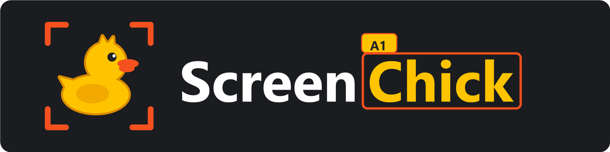
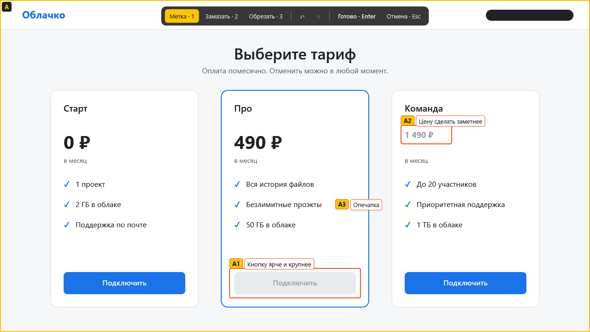
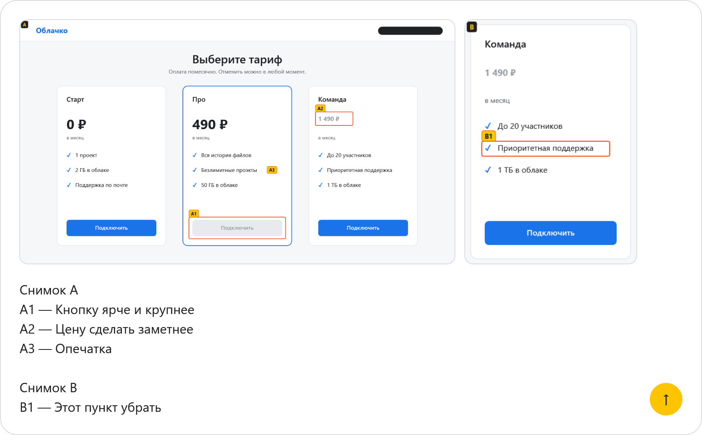
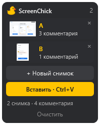

<p align="center">
  
</p>

<p align="center">
  <b>Русский</b> · <a href="README.en.md">English</a>
</p>

<h3 align="center">Обвёл, подписал, нажал Ctrl+V. Чат сразу понял, о чём ты.</h3>

<p align="center">Скриншоты с метками и комментариями для ИИ-ассистентов и рабочих чатов.</p>

<p align="center">
  <a href="https://github.com/EvgLans/ScreenChick/releases/latest"></a>
  <a href="https://github.com/EvgLans/ScreenChick/releases"></a>
  <a href="LICENSE"></a>
</p>

<p align="center">
  
</p>
<p align="center"><sub>Страница тарифов вымышленная. Метки и панель настоящие, их нарисовала сама программа.</sub></p>

## Как это работает

<table>
  <tr>
    <th width="33%">1. Сними</th>
    <th width="33%">2. Отметь</th>
    <th width="33%">3. Вставь</th>
  </tr>
  <tr>
    <td valign="top"><b>Print Screen</b> замораживает монитор под курсором. Клавишу можно сменить в настройках.</td>
    <td valign="top">Обведи место или кликни по нему и напиши комментарий. Лишнее можно замазать или обрезать.</td>
    <td valign="top">Поставь курсор в поле чата и нажми <b>Ctrl+V</b>. Сначала вставятся снимки, затем комментарии. «Отправить» нажимаешь сам.</td>
  </tr>
</table>

Вот что окажется в поле чата, а снимки останутся ждать в боковой ленте:

<table>
  <tr>
    <td width="74%"></td>
    <td valign="top" align="center"></td>
  </tr>
</table>

## Что умеет

- **Метки с номерами.** Каждый комментарий говорит, к какому месту он относится: A1, A2, B1.
- **Замазка и обрезка.** Итоговая картинка собирается заново, поэтому под замазкой исходных пикселей не остаётся.
- **До 26 снимков за раз.** Все они вставляются одним Ctrl+V.
- **Одни снимки, много чатов.** После вставки снимки остаются в ленте, пока ты её не очистишь.
- **Не мешает работать.** Скопировал что-то другое, и Ctrl+V вставит это. Снимки по-прежнему вставляет кнопка в ленте.
- **Русский и английский.** Язык берётся из Windows, его можно сменить в настройках.

## Установка

Скачай `ScreenChick-Setup-*.exe` со страницы [Releases](https://github.com/EvgLans/ScreenChick/releases/latest) и запусти. Нужна 64-битная Windows 10 или 11. Права администратора и отдельный .NET не нужны: среда выполнения входит в установщик, а программа ставится только для текущего пользователя.

<details>
<summary><b>Windows показывает предупреждение SmartScreen</b></summary>
<br>

Установщик не подписан, поэтому Windows может предупредить об этом. Нажми «Подробнее», затем «Выполнить в любом случае». Если не хочешь доверять готовому файлу, собери программу из исходников, инструкция ниже.

</details>

<details>
<summary><b>Обновление и удаление</b></summary>
<br>

Перед обновлением и удалением закрой приложение через меню в трее. Удаляется оно через «Приложения» в параметрах Windows; файл настроек в `%APPDATA%\ScreenChick` при этом остаётся.

</details>

## Где работает

| Чат | Вставка снимков и текста |
|---|---|
| Claude | ✅ |
| Telegram | ✅ |
| ChatGPT | ✅ |
| Режим ИИ в Google | ✅ |
| WhatsApp, Cursor и другие | пока не проверено, будем рады сообщениям в [Issues](https://github.com/EvgLans/ScreenChick/issues) |

Программа тестировалась на одном компьютере с Windows 10. Linux и macOS не поддерживаются: приложение построено на WPF и функциях Windows.

## Как пользоваться

Приложение живёт в трее: левый клик делает снимок, правый открывает меню с настройками и выходом. Автозапуск можно включить при установке или в настройках.

| В режиме снимка | |
|---|---|
| `1` / `2` / `3` | метка / замазать / обрезать |
| колесо мыши | толщина замазывания |
| `Ctrl+Z` / `Ctrl+Y` | отменить / вернуть, без ограничения шагов |
| клик по метке | поправить или удалить |
| `Enter` | сохранить снимок |
| `Esc` | выйти без сохранения (если есть правки, то двойным нажатием) |

Метка и буква снимка не закрывают обведённое: они встают рядом, а внутри окажутся, только если вокруг нет места.

<details>
<summary><b>Как ведёт себя Ctrl+V</b></summary>
<br>

- Пока лента пуста, Ctrl+V работает как обычно.
- Пока в ленте есть снимки, Ctrl+V вставляет их в любое окно, в том числе повторно.
- Если после снимка или вставки ты что-то скопировал, Ctrl+V вставит скопированное, а снимки останутся в ленте. Для них есть кнопка «Вставить» в ленте.
- Если во время вставки переключиться в другое окно, она остановится, чтобы снимки не попали не туда. Лента при этом сохранится, но уже вставленные снимки при повторе вставятся снова.
- Если чат принимает не все снимки, увеличь паузу между картинками в настройках.
- В окна, запущенные от администратора, Ctrl+V не перехватывается: так устроена защита Windows.

</details>

## Конфиденциальность

- В программе нет сетевого кода, телеметрии и обновлений через интернет.
- Снимки хранятся только в памяти и пропадают при очистке ленты или выходе из программы. На диск записываются только настройки.
- Снимки не попадают в журнал буфера обмена Windows (Win+V) и в его облачную синхронизацию.
- Чтобы работали клавиша снимка и Ctrl+V, программа ставит глобальный перехват клавиатуры. Он видит все нажатия, но реагирует только на эти две комбинации и ничего не записывает. Проверить это можно в [`KeyRouter.cs`](src/ScreenChick/Input/KeyRouter.cs). Из-за такого перехвата антивирус может отнестись к программе настороженно.

<details>
<summary><b>Сборка из исходников</b></summary>
<br>

Нужен .NET 10 SDK.

```
dotnet test
dotnet run --project src\ScreenChick
```

Установщик собирается с помощью Inno Setup 6 и появляется в папке `dist`:

```
winget install --id JRSoftware.InnoSetup -e --scope user
powershell -ExecutionPolicy Bypass -File installer\build.ps1
```

`SCREENCHICK_PREVIEW_DIR=<папка>` при запуске тестов дополнительно сохраняет PNG окон, отрисованных без показа на экране. Так получены картинки на этой странице.

</details>

## Лицензия

[MIT](LICENSE). В установщик входит среда выполнения .NET от .NET Foundation и Microsoft; её лицензии лежат в папке `licenses` рядом с установленной программой. Установщик создан с помощью [Inno Setup](https://jrsoftware.org/isinfo.php).
